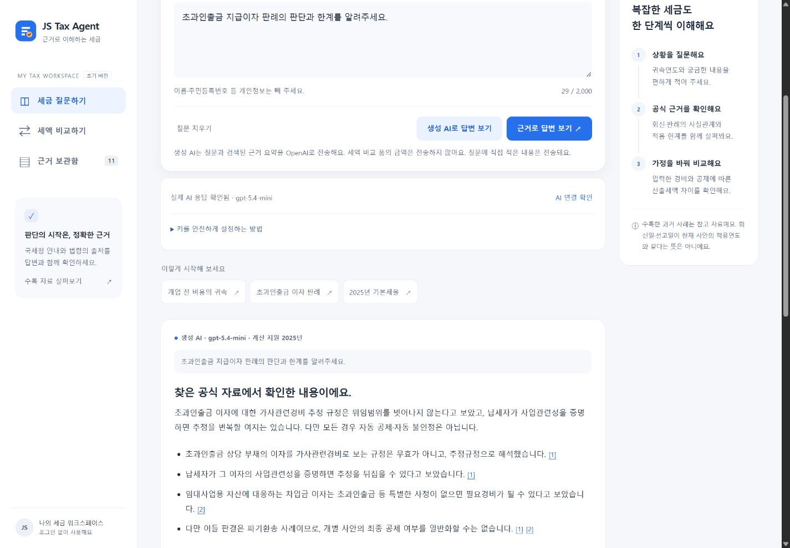

# JS Tax Agent

종합소득세·법인세·부가가치세·상속세·증여세의 공식 근거를 찾고 가정에 따른 세액을 비교하는 한국어 웹 앱입니다.

[GitHub 저장소](https://github.com/JoonseokWon/js-tax-agent) · [릴리스 다운로드](https://github.com/JoonseokWon/js-tax-agent/releases) · [호스팅 체험판](https://js-tax-agent.keengiant19.chatgpt.site) (소유자 개인 접근 권한, ChatGPT 로그인 필요)

현재 소스는 **v0.3.0**입니다. 세목별 공식 자료 검색, 법령 시점 검토와 A/B 비교를 제공합니다. 자료 요약과 세액 비교는 키 없이 사용할 수 있습니다. 생성 AI에는 서버 API 키와 공급자의 사용 가능 한도가 필요하며, 새 세목의 실제 생성 답변 평가는 진행하지 않았습니다.



## 실행

Node.js **22.9 이상**만 필요합니다. 별도 패키지 설치나 API 키 없이 실행됩니다.

```powershell
Set-Location -LiteralPath 'C:\Users\user\Documents\For ax node Project\JS Tax Agent'
node server.mjs
```

표시된 `http://127.0.0.1:4317`을 엽니다. 종료는 `Ctrl+C`입니다. `start.ps1` 또는 `node --env-file-if-exists=.env server.mjs`로 실행하면 선택 설정 파일도 읽습니다. 포트가 사용 중이면 `$env:PORT = '4320'`으로 변경합니다.

```powershell
node scripts/test.mjs
node scripts/build.mjs
```

`dist/`는 위 명령의 정적 빌드 결과물입니다. `index.html`을 파일로 직접 열지 말고 HTTP 서버를 사용하세요. npm이 있는 환경에서는 `npm start`, `npm test`, `npm run build`도 가능합니다. 런타임 외부 의존성은 없습니다.

Worker 빌드와 전체 테스트에는 개발 의존성 설치가 필요합니다. pnpm 11.25.0에서 `pnpm install --frozen-lockfile`을 실행하세요. `node scripts/build-site.mjs`는 Sites에 배포할 서버와 웹 자산을 단일 Worker로 묶으며, 정적 빌드와 같은 `dist/`를 사용합니다. 프로젝트의 고정된 esbuild 설치 스크립트만 허용합니다.

## 할 수 있는 일

- 공식 자료 33개에는 법령·국세청 안내, 국세청 질의회신 7건과 대법원 판례 7건이 포함됩니다. 세목·자료 종류·문서번호로 찾고 원문을 확인합니다.
- 절세 검토 단계에서 기준일과 법령 연혁, 부칙, 실제 사실관계와 증빙을 확인한 뒤 A/B 조건을 입력합니다. 계산 지원 연도를 벗어난 기준일은 계산을 보류합니다.
- 법제처 공개 API로 법령 연혁과 해석·판례 목록을 수집하고 변경을 확인하는 [검토 후보 수집 도구](docs/law-discovery.md)를 제공합니다. 승인된 별도 인증값이 필요합니다.
- 질문·근거·비교 조건·제외 범위를 검토 메모 Markdown으로 다운로드.
- 데스크톱·모바일 화면, 키보드 포커스·라벨, 입력 오류와 빈 검색 상태.

기본 답변은 검색한 자료의 요약입니다. 과거 사례에는 당시 사실관계와 적용 한계를 표시합니다. 소득세법 제27조의 2026년 시행 조문은 참고 보관함에서 볼 수 있습니다. 새로운 법령 버전이나 수집 후보는 조문과 적용례 검토를 거친 뒤 반영합니다.

## 선택: 생성 AI RAG

OpenAI Developers의 보안 키 설정 또는 [로컬 보안 실행 안내](docs/api-key-setup.md)를 사용하세요. API 키를 채팅·웹 입력란·GitHub에 붙여 넣지 마세요. 서버는 `OPENAI_API_KEY`와 선택값 `OPENAI_MODEL`을 읽습니다. 로컬 설정 파일을 사용하는 경우 Git에서 제외된 `.env`를 지원합니다.

키 설정 후 `node --env-file-if-exists=.env server.mjs`로 실행하고 화면의 **AI 연결 확인**을 선택하면 공개 예시 1건으로 실제 연결을 확인합니다. 또는 `node --env-file-if-exists=.env scripts/check-ai.mjs`를 사용하세요. 연결 확인과 생성 질문은 API 사용량이 발생하며, 화면 열기·설정 상태 조회·자료 요약·세액 비교는 API를 호출하지 않습니다. 무료 크레딧만 사용할 때는 유효한 무료 잔액과 계정 결제 상태를 먼저 확인하세요. 앱이 계정 결제 설정을 변경하거나 충전하지는 않습니다.

생성 질문을 선택할 때 질문과 검색된 근거의 자체 요약·사례 사실관계·적용 한계가 OpenAI로 전송됩니다. 세액 비교 폼의 금액은 전송하지 않습니다. 질문에 직접 입력한 금액은 질문의 일부로 전송됩니다. Responses API의 `store:false`를 사용하며, 이는 모든 제공자 로그의 부재를 의미하지 않습니다. 키는 서버 환경에만 두며 브라우저로 보내지 않습니다. 로컬 서버는 루프백 주소에만 바인딩됩니다.

생성 답변은 문장별로 제공된 근거 ID만 인용하도록 구조화하고 서버에서 검증합니다. 이는 문장 전체의 정확성을 보증하지 않습니다. `gpt-5.4-mini`로 개업 전 비용 질문과 초과인출금 이자 판례 질문의 실제 응답·인용·적용 한계를 확인했습니다. 판례 답변의 화면 표시와 메모 다운로드도 검증했습니다. 두 예시의 성공이 모든 세무 질문의 정확성이나 전문가 검토를 대신하지 않습니다.

Sites Worker는 개인 접근 권한과 로그인 사용자 확인을 유지합니다. API 키는 런타임 비밀값으로 주입하고 공개 소스·브라우저·배포 번들에는 포함하지 않습니다. 설정 절차는 [키 설정 안내](docs/api-key-setup.md)를 확인하세요. 동시 요청·분당 제한은 인스턴스 단위이며 영구적인 계정 과금 한도가 아닙니다.

API 참고: [OpenAI 텍스트 생성](https://developers.openai.com/api/docs/guides/text), [Responses API](https://developers.openai.com/api/reference/resources/responses/methods/create).

## 계산 범위

| 세목 | 지원 범위 | 예시 |
| --- | --- | --- |
| 종합소득세 | 2025년 장부에 의한 단일 사업소득. 수입 − 필요경비 − 소득공제에 일반 누진세율 적용 | 828만원 → 601만5천원 |
| 법인세 | 2026년에 시작하는 1년 사업연도의 국내 일반 영리법인. 세무조정 후 과세표준에 일반 누진세율 적용 | 3,000만원 → 1,800만원 |
| 부가가치세 | 2026년 일반과세자 국내 10% 과세 매출. 매출세액에서 공제 가능 매입세액 차감 | 300만원 납부 → 200만원 환급 |
| 상속세 | 2026년 상속개시. 상속세 과세가액에서 확인한 공제와 감정평가 수수료를 뺀 뒤 일반세율 적용 | 5,000만원 → 3,000만원 |
| 증여세 | 2026년 증여. 증여세 과세가액에서 확인한 공제와 감정평가 수수료를 뺀 뒤 일반세율 적용 | 1,000만원 → 500만원 |

상속세·증여세는 검토한 과세가액과 적용 가능한 공제·수수료를 입력해 **산출세액**을 비교합니다. 재산 평가, 사전 증여의 합산, 공제 자격·한도, 특례·할증·세액공제·가산세는 원문에서 별도로 확인하세요.

특례, 최종 신고 조정 및 제외 항목은 세목별 화면의 계산 범위를 확인하세요. 실제 적용 여부는 적용 기간의 원문과 부칙, 거래 사실과 증빙을 확인해야 합니다.

## 구조와 작업 기록

- `public/`: 화면·스타일·한국어 검색·세액 엔진·공식 자료 요약.
- `server.mjs`, `lib/`, `worker/`: 로컬/호스팅 공용 API, 생성 RAG와 Worker 진입점.
- `tests/`: 세율 경계·검색 평가·입력 오류·API 계약/실패 검증.
- `scripts/`: 정적/Worker 빌드·AI 연결 검증·릴리스 지원 도구.
- `docs/spec.md`, `plan.md`, `todo.md`, `design.md`: 요구사항·계획·진행·화면 규칙.
- `docs/sources.md`, `validation.md`, `handoff.md`: 출처·검증 결과·인계.

## 라이선스

애플리케이션 코드는 MIT입니다. 공식 자료 자체의 권리는 각 원출처에 따릅니다. 이 저장소는 제한된 자체 요약과 원문 링크를 제공하며 국세청 공식 서비스가 아닙니다.
