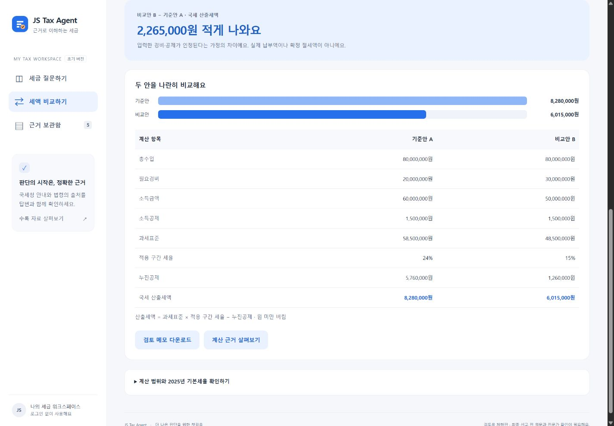

# JS Tax Agent

공식 근거를 확인하고 종합소득세의 가정에 따른 산출세액을 비교하는 한국어 웹 앱입니다. **2025년 귀속, 장부에 의한 단일 사업소득 검토용 첫 버전**입니다.

[GitHub 저장소](https://github.com/JoonseokWon/js-tax-agent) · [공개 릴리스](https://github.com/JoonseokWon/js-tax-agent/releases) · [호스팅 체험판](https://js-tax-agent.keengiant19.chatgpt.site) (소유자 개인 접근 권한, ChatGPT 로그인 필요)

현재 소스는 **v0.2.0**입니다. 국세청 회신·판례와 실제 AI 질의응답을 추가했습니다. 로컬 AI는 공개 예시 2건으로 검증했습니다. 호스팅 체험판은 v0.1.0이며, v0.2 Worker 배포는 서버 비밀값의 안전한 등록 경로 확보를 기다리고 있습니다. 실제 상태는 [검증 기록](docs/validation.md)을 확인하세요.



## 실행

Node.js **22.9 이상**만 필요합니다. 별도 패키지 설치나 API 키 없이 실행됩니다.

```powershell
Set-Location -LiteralPath 'C:\Users\user\Documents\For ax node Project\JS Tax Agent'
node server.mjs
```

표시된 `http://127.0.0.1:4317`을 엽니다. 종료는 `Ctrl+C`입니다. `start.ps1` 또는 `node --env-file-if-exists=.env server.mjs`로 실행하면 선택 설정 파일도 읽습니다. 포트가 사용 중이면 `$env:PORT = '4320'`으로 변경합니다.

```powershell
node scripts/test.mjs
node scripts/build.mjs
```

`dist/`는 위 명령의 정적 빌드 결과물입니다. `index.html`을 파일로 직접 열지 말고 HTTP 서버를 사용하세요. npm이 있는 환경에서는 `npm start`, `npm test`, `npm run build`도 가능합니다. 런타임 외부 의존성은 없습니다.

Worker 빌드와 전체 테스트에는 개발 의존성 설치가 필요합니다. pnpm 11.25.0에서 `pnpm install --frozen-lockfile`을 실행하세요. `node scripts/build-site.mjs`는 Sites에 배포할 서버와 웹 자산을 단일 Worker로 묶으며, 정적 빌드와 같은 `dist/`를 사용합니다. 프로젝트의 고정된 esbuild 설치 스크립트만 허용합니다.

## 할 수 있는 일

- 공식 자료 11개: 국세청 안내 4개·질의회신 3개·대법원 판례 3개·참고 법령 1개. 출처·날짜·사실관계·판단·적용 한계를 확인하고 원문 열기.
- 한국어 키워드·동의어·문서/사건번호 검색, 자료 종류 필터, 사업자등록 전 비용에 관한 상호 보완 회신 동시 확인. 미수록 사건번호·세목·연도나 근거가 부족한 질문은 답변 유보.
- 기준안/비교안의 총수입·필요경비·소득공제를 입력해 산출세액·과세표준·구간 세율과 차이 비교.
- 질문·근거·비교 조건·제외 범위를 검토 메모 Markdown으로 다운로드.
- 데스크톱·모바일 화면, 키보드 포커스·라벨, 입력 오류와 빈 검색 상태.

기본 답변은 **검색한 자료의 요약 조합이며 생성 AI를 사용하지 않습니다.** 과거 사례는 당시 사실관계와 적용 한계를 함께 제시하며, 2025년 세액 계산 규칙과 구분합니다. 소득세법 제27조의 2026년 시행 조문은 참고 보관함에만 둡니다. 전체 질의회신·판례 검색, 자동 법령 갱신과 임베딩 검색은 후속 범위입니다.

## 선택: 생성 AI RAG

OpenAI Developers의 보안 키 설정 또는 [로컬 보안 실행 안내](docs/api-key-setup.md)를 사용하세요. API 키를 채팅·웹 입력란·GitHub에 붙여 넣지 마세요. 서버는 `OPENAI_API_KEY`와 선택값 `OPENAI_MODEL`을 읽습니다. 로컬 설정 파일을 사용하는 경우 Git에서 제외된 `.env`를 지원합니다.

키 설정 후 `node --env-file-if-exists=.env server.mjs`로 실행하고 화면의 **AI 연결 확인**을 선택하면 공개 예시 1건으로 실제 연결을 확인합니다. 또는 `node --env-file-if-exists=.env scripts/check-ai.mjs`를 사용하세요. 연결 확인과 생성 질문은 API 사용량이 발생하며, 화면 열기·설정 상태 조회·자료 요약·세액 비교는 API를 호출하지 않습니다. 무료 크레딧만 사용할 때는 유효한 무료 잔액과 계정 결제 상태를 먼저 확인하세요. 앱이 계정 결제 설정을 변경하거나 충전하지는 않습니다.

생성 질문을 선택할 때 질문과 검색된 근거의 자체 요약·사례 사실관계·적용 한계가 OpenAI로 전송됩니다. 세액 비교 폼의 금액은 전송하지 않습니다. 질문에 직접 입력한 금액은 질문의 일부로 전송됩니다. Responses API의 `store:false`를 사용하며, 이는 모든 제공자 로그의 부재를 의미하지 않습니다. 키는 서버 환경에만 두며 브라우저로 보내지 않습니다. 로컬 서버는 루프백 주소에만 바인딩됩니다.

생성 답변은 문장별로 제공된 근거 ID만 인용하도록 구조화하고 서버에서 검증합니다. 이는 문장 전체의 정확성을 보증하지 않습니다. `gpt-5.4-mini`로 개업 전 비용 질문과 초과인출금 이자 판례 질문의 실제 응답·인용·적용 한계를 확인했습니다. 판례 답변의 화면 표시와 메모 다운로드도 검증했습니다. 두 예시의 성공이 모든 세무 질문의 정확성이나 전문가 검토를 대신하지 않습니다.

Sites Worker는 개인 접근 권한과 로그인 사용자 확인을 유지하도록 구현했습니다. 호스팅 키는 로컬 `.env`와 별개인 런타임 비밀값으로 등록해야 합니다. 현재 이 전달 단계는 미완료이며 v0.2 Worker는 배포하지 않았습니다. 동시 요청·분당 횟수 제한은 인스턴스 단위이며 영구적인 계정 과금 한도가 아닙니다. 정적 빌드만 호스팅하면 서버 AI 기능은 제공되지 않습니다.

API 참고: [OpenAI 텍스트 생성](https://developers.openai.com/api/docs/guides/text), [Responses API](https://developers.openai.com/api/reference/resources/responses/methods/create).

## 계산 범위

`과세표준 = max(0, 총수입 − 필요경비 − 소득공제)`

`국세 산출세액 = floor(과세표준 × 구간 세율) − 누진공제`

지방소득세, 다른 소득 합산, 결손금, 추계신고, 분리과세, 세액공제·감면, 가산세, 기납부세액은 제외합니다. 경비와 공제의 인정 여부를 자동 판단하지 않습니다. 결과는 최종 납부액·환급액이나 확정 절세액이 아닙니다. 신고 전 해당 귀속연도 원문과 사실관계를 확인해야 합니다.

예시: 총수입 8,000만원, 경비 2,000만원, 공제 150만원은 산출세액 828만원. 경비를 3,000만원으로 바꾸면 601만5천원, 차이는 226만5천원입니다.

## 구조와 작업 기록

- `public/`: 화면·스타일·한국어 검색·세액 엔진·공식 자료 요약.
- `server.mjs`, `lib/`, `worker/`: 로컬/호스팅 공용 API, 생성 RAG와 Worker 진입점.
- `tests/`: 세율 경계·검색 평가·입력 오류·API 계약/실패 검증.
- `scripts/`: 정적/Worker 빌드·AI 연결 검증·릴리스 지원 도구.
- `docs/spec.md`, `plan.md`, `todo.md`, `design.md`: 요구사항·계획·진행·화면 규칙.
- `docs/sources.md`, `validation.md`, `handoff.md`: 출처·검증 결과·인계.

## 라이선스

애플리케이션 코드는 MIT입니다. 공식 자료 자체의 권리는 각 원출처에 따릅니다. 이 저장소는 제한된 자체 요약과 원문 링크를 제공하며 국세청 공식 서비스가 아닙니다.
